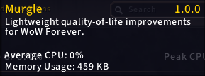
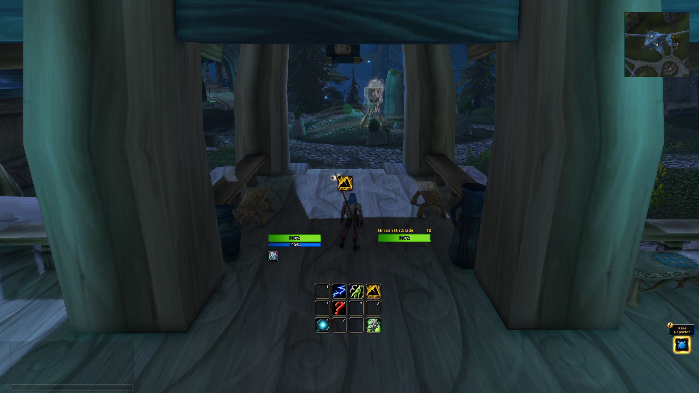

# Murgle


Lightweight, native-first quality-of-life improvements for WoW Forever.

[GitHub releases](https://github.com/Jordinarily/murgle/releases/latest) · [CurseForge](https://www.curseforge.com/wow/addons/murgle) · [WowUp Hub](https://wowup.io/addons/2797949)

Murgle is for players who like Blizzard's UI, but want it cleaner, less intrusive and a little smarter.

It removes unnecessary clutter, automates repetitive interactions and exposes useful native functionality without replacing the game's interface with a large addon framework.

> Blizzard, just cleaner.

Open **Settings → AddOns → Murgle**, or type `/murgle`.

Options use Blizzard's standard controls baked directly into native settings across five focused categories:
**Combat & Frames**, **Map & Quests**, **Items & Services**, **Chat & Tooltips**, and **Errors & Sound**.
Saved choices are preserved. Blizzard's Defaults action resets settings in the selected category.

---

## Lightweight by design

Performance is a core part of Murgle's design rather than an afterthought.

The in-game profiler reported 0% average CPU and approximately 459 KB memory
during testing. These are reported measurements, not a claim of zero CPU cost.

Murgle has:

- No external runtime libraries
- No Ace3 or LibStub
- No permanent polling loops
- Native settings controls instantiated by Blizzard when displayed

Murgle prefers Blizzard's own APIs, CVars and UI elements wherever possible.

Its general approach is:

Native Blizzard functionality → one-time change → event → narrow hook

Continuous background processing and replacement systems are deliberately avoided.

> Performance figures were measured during in-game testing and may vary depending on enabled features and client state.



---

## Highlights

### Clean up Blizzard's interface

Remove the parts of the default UI you don't need while keeping Blizzard's underlying interface intact.

- Hide Micro Menu
- Hide Bag Bar
- Move the combined bag window by dragging its title and remember its position
- Hide Status Bar 1
- Hide XP bar
- Hide Talking Head
- Hide Boss Banner
- Hide large zone text
- Hide Objective Tracker headers
- Control Objective Tracker visibility
- Show the buff collapse arrow only on hover

---

### Combat & Frames

Keep combat clean, responsive, and uncluttered.

#### Spell Queue Window

Adjust WoW's native Spell Queue Window directly from Murgle.

- Adjustable 0–400 ms slider
- Blizzard default clearly marked at 400 ms
- On-demand latency-based auto-detection button
- Built-in help explaining how to tune the value
- No continuous latency monitoring

#### Compact Blizzard Unit Frames

Murgle cleans up Blizzard's existing secure unit frames without replacing them:

- **Hide player name:** Suppresses the player name text above the player frame.
- **Hide player frame:** Cleanly hides the player frame (with combat deferral).
- **Compact frames:** Single streamlined toggle that cleans up Player, Target, Focus, and Target-of-Target frames together (removes portrait art and circular backgrounds while keeping the native shaped HP/mana bar borders, textures, and geometry).

---

### Map & Quests

#### Clean Square Minimap

- **Clean square minimap:** Single toggle bundling the square minimap shape, clean edges, and removal of decorative borders, day/night wheel, zone text, calendar, addon compartment, and zoom buttons.
- **Hide clock:** Independent toggle to show or hide the minimap clock.
- **Hide tracking:** Independent toggle to show or hide the tracking button.

#### Quests & Interactables

- **Loot & quest sparkles:** Re-enables Blizzard's classic sparkle effect on herbs, ore nodes, quest objects, corpses, and interactables instead of modern outline highlighting.
- **Objective tracker headers:** Toggle to hide or show tracker headers.
- **Objective tracker visibility:** Always show, hide in combat, or only show out of combat.
- **Show reward values:** Marks quest reward items with their vendor value to pick the most profitable reward.
- **Auto-accept & auto-turn-in:** Conservative quest automation for routine quests without reward choices or costs; bypassed in combat or when holding Shift.

---

### Items & Services

Small native conveniences for inventory, merchants, and services.

- **Fast Loot:** Instant, sequential looting following native Auto Loot rules and modifiers.
- **Ammo count:** Displays equipped ammunition totals above the backpack button.
- **Auto repair & Guild repair:** Automatically repairs gear at capable merchants with optional guild bank funding.
- **Sell junk:** Sells eligible poor-quality items on merchant visit.
- **Bulk buy:** Shift-click merchant items to purchase across stacks.
- **Train all:** Train all available spells at class trainers with a single click.
- **Skip service gossip:** Opens flight maps and services directly when only one option exists.
- **Skip confirmation dialogs:** Optional toggles to skip confirmation on bind-on-pickup loot and loot rolls.

---

### Chat & Tooltips

#### Chat Frame

- **Clean chat frame:** Consolidates chat buttons (Menu, Channels, Quick Join) and voice buttons (Mute, Deafen) into a clean, minimal chat window.
- **Hide combat log:** Suppresses the Combat Log tab.
- **Chat tabs:** Configure tab visibility behavior (Show, Fade, or Hide).

#### Tooltips

- **Anchor to cursor:** Anchors tooltips to the mouse cursor (left, right, or centered).
- **Hide in combat:** Suppresses unit, object, and corpse tooltips during combat to reduce visual clutter.

---

### Errors & Sound

#### Error Messages

- Filter repetitive error spam (All vs. Important only).

#### Selective Sound Muting

- Mute specific repetitive sound groups (Spell fizzles, Error speech, Train emotes, Mechanical footsteps, Mounts, Zeppelins, Clock chimes, etc.) without muting the whole game.

---

### World Refresh Handling

Handles WoW Forever's World Refresh warning prompts safely:

- **Just hide:** Hides the automatic warning prompt without cancelling the scheduled transfer.
- **Accept & hide:** Accepts the transfer and hides the prompt (not recommended for Hardcore characters).

---

## Why Murgle?

Murgle is deliberately not a complete UI replacement.

It's designed for players who:

- like Blizzard's default UI
- want less visual clutter
- want useful automation without losing control
- don't want ten separate addons for ten small fixes
- care about addon CPU and memory usage
- prefer native game functionality over replacement systems

If you're looking for hundreds of appearance controls or a complete UI framework, Murgle probably isn't trying to be that.

If you want Blizzard, just cleaner, that's the point.

---

Murgle in normal gameplay — Blizzard's UI, with less clutter.



## Installation

### GitHub

Download the packaged Murgle ZIP from:

[Latest GitHub Release](https://github.com/Jordinarily/murgle/releases/latest)

Use the release attachment rather than GitHub's automatically generated source-code archives.

Extract it so the addon is located at:

```text
World of Warcraft/_classic_beta_/Interface/AddOns/Murgle
```

The manifest should be at `Murgle/Murgle.toc`, without another nested Murgle folder.
Enable Murgle in the addon list, then enter `/murgle`. Use `/reload` after updating.
WoW Forever only; other WoW clients are not supported.

### CurseForge

[View Murgle on CurseForge](https://www.curseforge.com/wow/addons/murgle)

### WowUp

[View Murgle on WowUp Hub](https://wowup.io/addons/2797949)

Use Get Addons → Install from URL with:

`https://github.com/Jordinarily/murgle`

## Commands

- `/murgle` — open or close settings.
- `/murgle v` or `/murgle version` — show the installed version.
- `/murgle r` or `/murgle reset` — reset settings after confirmation.
- `/rl` — reload the UI, if the alias was free when Murgle loaded.

## Important behaviour

- Settings are account-wide. Combat-sensitive changes wait until combat ends.
- Hold Shift to bypass quest automation, World Refresh handling, automatic
  repair and junk selling. These actions also skip combat.
- Talking Head, boss-banner and large zone-text suppression, Fast Loot and World
  Refresh are enabled by default. World Refresh starts in Just hide mode;
  error filtering starts at Important only. Other feature toggles start off.
- Enable all / Disable all affect boolean controls on the current page and
  preserve modes and slider values. On Automation and Loot & Vendors, enabling
  all also enables the page's quest or spending automation.
- Reset Murgle resets all pages after confirmation and sets Spell Queue Window
  to 400 ms. Opening settings or first installation leaves the native queue value alone.
- Auto repair requires enough funds for the full cost. Permitted guild funds can
  cover part of the cost, with personal gold covering the remainder.
- Minimap rim hiding is available outside square mode. Disabling Square Minimap
  restores the native round appearance and standard ring values.
- Quest-object sparkles change native graphics preferences. Turn the option off
  before disabling Murgle to restore them. Graphics presets can override the effect;
  toggle it off and on to reapply.
- Reputation watching handles recognised gains outside combat and keeps the last
  watched faction when disabled.
- Footstep and hoof muting includes nearby units. Piccolo muting also silences
  warlock Seduction. Unmute before disabling Murgle. Native file unmuting cannot
  preserve overlapping mutes from other addons.
- Error filtering also suppresses the filtered message's audio.

Use the ? beside a setting for additional details.

## Feedback and feature requests

Found a bug or have a suggestion? Use [GitHub Issues](https://github.com/Jordinarily/murgle/issues).
For bugs, include your Murgle version, what happened and how to reproduce it.

Suggestions that use native Blizzard functionality with little or no idle overhead
fit Murgle's focus best.

See the [changelog](https://github.com/Jordinarily/murgle/blob/main/CHANGELOG.md) for release details.

## Support Murgle

Murgle is free to use and its functionality is never paywalled.

[](https://ko-fi.com/jordinarily)

Support is completely optional and does not unlock any features.

## Licence

Copyright (c) 2026 Jordinarily. All rights reserved.

Murgle is proprietary software available for personal, non-commercial use.
See [LICENSE](https://github.com/Jordinarily/murgle/blob/main/LICENSE) for the full terms.
