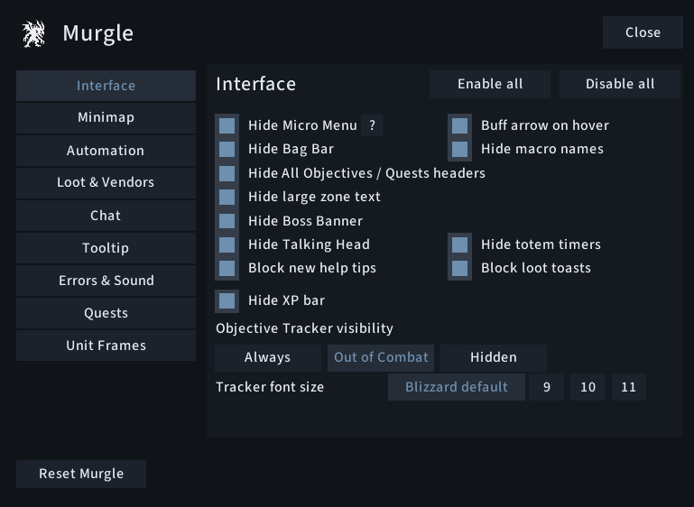
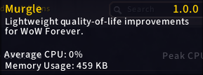
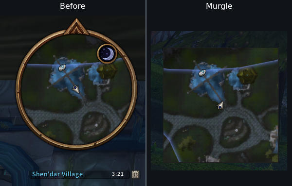
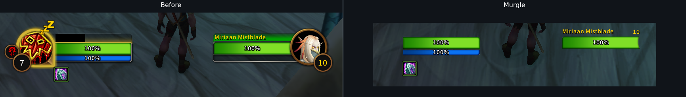
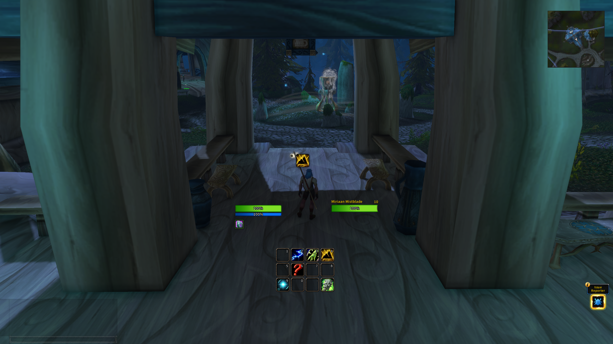

# Murgle


Lightweight, native-first quality-of-life improvements for WoW Forever.

Murgle is for players who like Blizzard's UI, but want it cleaner, less intrusive and a little smarter.

It removes unnecessary clutter, automates repetitive interactions and exposes useful native functionality without replacing the game's interface with a large addon framework.

> Blizzard, just cleaner.



---

## Lightweight by design

Performance is a core part of Murgle's design rather than an afterthought.

The in-game profiler reported 0% average CPU and approximately 459 KB memory
during testing. These are reported measurements, not a claim of zero CPU cost.

Murgle has:

- No external runtime libraries
- No Ace3 or LibStub
- No permanent polling loops
- Settings UI created only when opened

Murgle prefers Blizzard's own APIs, CVars and UI elements wherever possible.

Its general approach is:

Native Blizzard functionality → one-time change → event → narrow hook

Continuous background processing and replacement systems are deliberately avoided.

> Performance figures were measured during in-game testing and may vary depending on enabled features and client state.



---

## Highlights

### Clean up Blizzard's interface

Remove the parts of the default UI you don't need while keeping Blizzard's underlying interface intact.

- Hide Micro Menu
- Hide Bag Bar
- Hide XP bar
- Hide macro names
- Hide totem timers
- Hide Talking Head
- Hide Boss Banner
- Hide large zone text
- Hide Objective Tracker headers
- Adjust Objective Tracker font size
- Control Objective Tracker visibility
- Show the buff collapse arrow only on hover
- Block new help tips
- Block standard loot-reward toasts

---

### A cleaner minimap

Keep Blizzard's minimap, but strip away unwanted artwork and buttons.

- Square Minimap with a subtle border
- Hide minimap rim
- Hide day/night artwork
- Hide minimap header
- Hide zone text
- Hide clock
- Hide calendar
- Hide tracking button
- Hide zoom buttons
- Hide addon compartment

Square mode uses the existing Blizzard minimap rather than replacing it.



---

### Compact Blizzard unit frames

Murgle cleans up Blizzard's existing secure unit frames instead of replacing them.

#### Player

- Compact Player Frame
- Remove portrait and decorative artwork
- Hide player level
- Hide resting artwork and animation
- Optional player-name hiding

#### Target

- Compact Target Frame
- Cleaner artwork and presentation
- Optional enemy-player faction icon filtering

#### Target of Target

- Compact Target-of-Target frame

Native health, power and unit-frame interactions remain intact.



---

### Native nameplate visibility

Control when Blizzard's own nameplates are shown without processing individual nameplates.

Available modes include:

Game settings · Combat · Hidden

Game settings means Murgle steps aside and respects your normal WoW configuration.

---

### Quest automation without losing control

Automate predictable quest interactions while leaving anything that needs an actual decision to the player.

- Auto-accept eligible quests
- Auto turn-in when no reward choice or money cost is involved
- Hold Shift to keep an interaction manual
- Automation is bypassed during combat
- Reward choices, uncertain quest states and special confirmations remain manual

Murgle intentionally keeps quest automation conservative.

---

### World Refresh handling

Murgle can handle WoW Forever's World Refresh warning through the specific native refresh UI.

Choose between:

Just hide

Hides the automatic warning. This does not cancel the scheduled transfer.

Accept & hide

Accepts the transfer and hides the warning.

> Accept & hide is not recommended for Hardcore characters.

Manually opened prompts remain available.

---

### Spell Queue Window

Adjust WoW's native Spell Queue Window directly from Murgle.

- Adjustable 0–400 ms
- Blizzard default clearly marked at 400 ms
- On-demand latency-based suggestion
- Built-in help explaining how to tune the value
- No continuous latency monitoring

Auto-detect samples World latency once, adds 150 ms, rounds to the nearest 10 ms and caps the suggestion at 400 ms.

It is intended as a starting point for manual adjustment rather than an automatically enforced value.

---

### Faster looting and vendors

Small conveniences for repetitive interactions.

#### Loot

- Fast Loot
- Follows WoW's native Auto Loot setting and modifier
- Locked slots and uncertain states remain under native handling

#### Vendors

- Auto repair
- Prefer permitted guild repair funds
- Personal-gold fallback
- Sell junk
- Only eligible unlocked poor-quality carried items with vendor value are sold

Repair and junk-selling changes take effect on the next merchant visit.

---

### Cleaner chat

Reduce Blizzard chat chrome without replacing the chat system.

- Hide Menu and Channel buttons
- Hide Combat Log tab
- Hide voice-chat buttons
- Default / Fade / Hide behaviour for regular and custom chat tabs

Faded tabs reappear when interacting with chat.

---

### Tooltip controls

Control where Blizzard tooltips appear and reduce combat clutter.

- Left of cursor
- Right of cursor
- At cursor
- Hide unit tooltips during combat
- Hide object tooltips during combat
- Hide corpse tooltips during combat

Item and spell tooltips remain available.

---

### Quest and reputation improvements

#### Quest objects

Use Blizzard's native sparkle effect for required quest objects instead of object outlines.

#### Reputation

Automatically watch a faction when a recognised reputation gain occurs.

---

### Errors and selective sound muting

Reduce repetitive error spam and mute specific sounds without muting the whole game.

#### Error messages

All · Important only

Important only hides common range, mana and item-cooldown errors.

#### Selective sound muting

Individual controls are available for 13 sound groups, including:

- Spell fizzles
- Error speech
- Train emotes
- Mechanical footsteps
- Footsteps
- Hooves
- Clock chimes
- UI clicks
- Ready checks
- Cat yawns
- Piccolo / Seduction
- Mechanostriders
- Zeppelins

Mute all listed / Unmute all listed affects only Murgle's listed sound groups.

---

## Why Murgle?

Murgle is deliberately not a complete UI replacement.

It's designed for players who:

- like Blizzard's default UI
- want less visual clutter
- want useful automation without losing control
- don't want ten separate addons for ten small fixes
- care about addon CPU and memory usage
- prefer native game functionality over replacement systems

If you're looking for hundreds of appearance controls or a complete UI framework, Murgle probably isn't trying to be that.

If you want Blizzard, just cleaner, that's the point.

---

Murgle in normal gameplay — Blizzard's UI, with less clutter.



## Installation

### GitHub

Download the packaged Murgle ZIP from:

[Latest GitHub Release](https://github.com/Jordinarily/murgle/releases/latest)

Use the release attachment rather than GitHub's automatically generated source-code archives.

Extract it so the addon is located at:

```text
World of Warcraft/_classic_beta_/Interface/AddOns/Murgle
```

The manifest should be at `Murgle/Murgle.toc`, without another nested Murgle folder.
Enable Murgle in the addon list, then enter `/murgle`. Use `/reload` after updating.
WoW Forever only; other WoW clients are not supported.

### CurseForge

[View Murgle on CurseForge](https://www.curseforge.com/wow/addons/murgle/preview)
— project preview; awaiting moderator approval.

### WowUp

Use Get Addons → Install from URL with:

`https://github.com/Jordinarily/murgle`

## Commands

- `/murgle` — open or close settings.
- `/murgle v` or `/murgle version` — show the installed version.
- `/murgle r` or `/murgle reset` — reset settings after confirmation.
- `/rl` — reload the UI, if the alias was free when Murgle loaded.

## Important behaviour

- Settings are account-wide. Combat-sensitive changes wait until combat ends.
- Hold Shift to bypass quest automation, World Refresh handling, automatic
  repair and junk selling. These actions also skip combat.
- Talking Head, boss-banner and large zone-text suppression, Fast Loot and World
  Refresh are enabled by default. World Refresh starts in Just hide mode;
  error filtering starts at Important only. Other feature toggles start off.
- Enable all / Disable all affect boolean controls on the current page and
  preserve modes and slider values. On Automation and Loot & Vendors, enabling
  all also enables the page's quest or spending automation.
- Reset Murgle resets all pages after confirmation and sets Spell Queue Window
  to 400 ms. Opening settings or first installation leaves the native queue value alone.
- Auto repair requires enough funds for the full cost. Permitted guild funds can
  cover part of the cost, with personal gold covering the remainder.
- Minimap rim hiding is available outside square mode. Disabling Square Minimap
  restores the native round appearance and standard ring values.
- Quest-object sparkles change native graphics preferences. Turn the option off
  before disabling Murgle to restore them. Graphics presets can override the effect;
  toggle it off and on to reapply.
- Reputation watching handles recognised gains outside combat and keeps the last
  watched faction when disabled.
- Footstep and hoof muting includes nearby units. Piccolo muting also silences
  warlock Seduction. Unmute before disabling Murgle. Native file unmuting cannot
  preserve overlapping mutes from other addons.
- Error filtering also suppresses the filtered message's audio.

Use the ? beside a setting for additional details.

## Feedback and feature requests

Found a bug or have a suggestion? Use [GitHub Issues](https://github.com/Jordinarily/murgle/issues).
For bugs, include your Murgle version, what happened and how to reproduce it.

Suggestions that use native Blizzard functionality with little or no idle overhead
fit Murgle's focus best.

See the [changelog](CHANGELOG.md) for release details.

## Support Murgle

Murgle is free to use and its functionality is never paywalled.

[](https://ko-fi.com/jordinarily)

Support is completely optional and does not unlock any features.

## Licence

Copyright (c) 2026 Jordinarily. All rights reserved.

Murgle is proprietary software available for personal, non-commercial use.
See [LICENSE](LICENSE) for the full terms.
